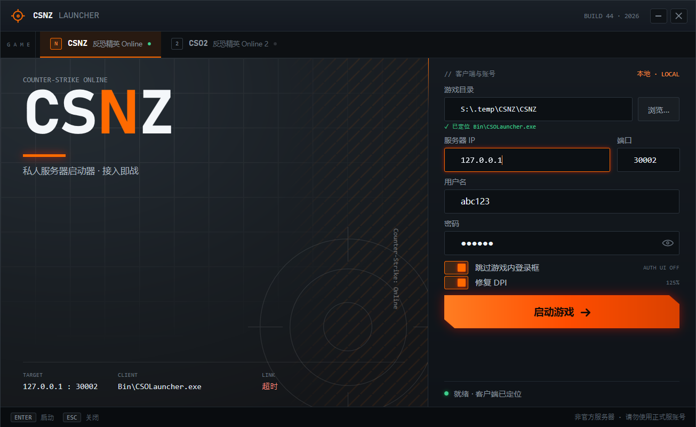

# CSNZ Launcher

CSO 私服启动器，一个窗口里支持 **CSNZ** 与 **CSO2** 两个客户端：顶部 tab 切换，两套面板共用同一副骨架。

WPF / .NET 10，无边框深色界面，单文件发布，不需要管理员权限。



## 功能

- **双游戏面板**：CSNZ / CSO2 各有一套游戏目录、服务器、账号与开关，切 tab 时海报和标题栏一起换
- **目录自动识别**：启动时从启动器所在目录向上找三层，用特征文件判断这里是哪个游戏，自动填好 `gameDir` 并切到对应 tab
- **连通性轮询**：每秒 TCP 探测一次当前游戏的服务器端口，tab 上的绿点表示客户端目录可用
- **高 DPI 修复**：启动前为目标 exe 写入 `~ HIGHDPIAWARE` 兼容性标记（可关）
- **配置持久化**：`launcher.json` 与 exe 同目录，旧的扁平配置会自动迁移到 `csnz` 节点

## 启动参数

```
CSNZ  <gameDir>\Bin\CSOLauncher.exe -ip <ip> -port <port> -login <u> -password <p> [-disableauthui]
CSO2  <gameDir>\Bin\launcher.exe    -masterip <ip> -masterport <port> -enablecustom -decryptedfiles -username <u> -password <p>
```

两个游戏的端口都会传给客户端，同时也是每秒连通性探测的目标端口。

## 目录结构

```
src/CSNZ.Launcher/    WPF 工程：界面、图标、逻辑
docs/                 截图与设计稿
.github/workflows/    CI：构建，推 tag 时发布 Release
```

## 构建

```powershell
dotnet build src/CSNZ.Launcher/CSNZ.Launcher.csproj -c Release
dotnet publish src/CSNZ.Launcher/CSNZ.Launcher.csproj -c Release -r win-x64 --self-contained false -p:PublishSingleFile=true -o dist
```

产物是框架依赖的单文件 exe，运行时需要 .NET 10 Desktop Runtime。
把 `CSNZ.Launcher.exe` 放进任意一个游戏根目录（与 `Bin` 同级）即可，启动器会自己认出是谁。

## 自动发布

推 `v` 开头的 tag 会触发 GitHub Actions：构建 → 上传产物 → 创建 Release。

```powershell
git tag v1.1.0
git push origin v1.1.0
```

## 配置文件

`launcher.json` 与 exe 同目录，删掉即可恢复默认：

```json
{
  "activeGame": "csnz",
  "csnz": {
    "gameDir": "S:\\games\\CSNZ",
    "ip": "127.0.0.1",
    "port": 30002,
    "login": "",
    "password": "",
    "disableAuthUi": true,
    "fixDpi": true,
    "featureFiles": ["Bin\\CSOLauncher.exe"]
  },
  "cso2": {
    "gameDir": "F:\\common\\cso2-cn",
    "ip": "127.0.0.1",
    "port": 30001,
    "login": "",
    "password": "",
    "enableCustom": true,
    "fixDpi": true,
    "featureFiles": ["Bin\\launcher.exe"]
  }
}
```

- `activeGame`：上次停在哪一边
- `featureFiles`：识别游戏目录用的特征文件（相对路径），**第一个同时作为启动目标**
- `fixDpi`：是否在启动前写高 DPI 兼容标记

## 设计稿

`docs/design-preview.html` 是最初的四套方案对比页（A 方案已落地），浏览器直接打开即可。
